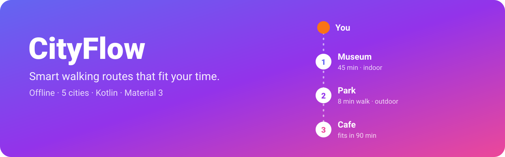
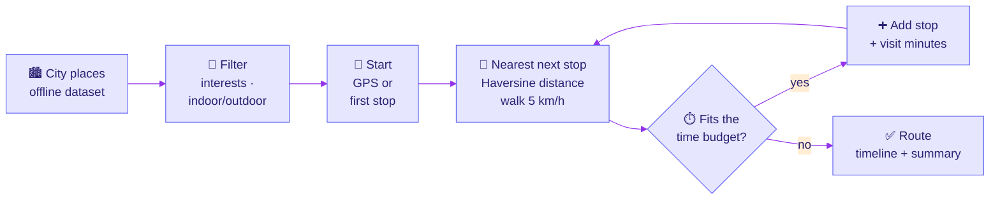
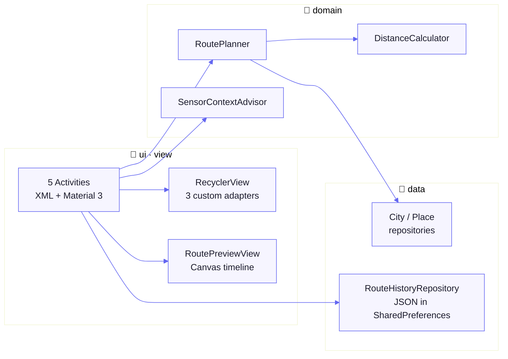

<div align="center">



# CityFlow: what should I do for the next 2 hours?

**Pick a city, set your time and interests. CityFlow builds a walking route through the best spots that fits exactly. Fully offline.**

<p align="center">
  
  
  
  
  
</p>

</div>

---

## 🧭 What it is

Travel apps list places. CityFlow answers a different question: *"I have 90 minutes, what should I do?"*
It turns your time budget, interests and indoor/outdoor mood into an ordered walk, with travel and visit time counted.
Everything (places, route maths, history) lives on the phone: the manifest does not even request `INTERNET`.

| | |
| --- | --- |
| **Cities** | Schmalkalden, Berlin, Munich, Astana, Almaty: 6–12 hand-picked real places each |
| **Time budget** | 30–240 minutes, filled as fully as possible |
| **Interests** | Old Town, University, Cafe, Park, Museum, Viewpoint, Library, Station, Historic Square… |
| **Mood** | Indoor, Outdoor or Any |
| **Start** | Your GPS position (optional) or the first stop |

## ✨ Features

- **🏙️ City onboarding**: pick a country and city on first launch; the choice is remembered.
- **🎯 Filters that never come up empty**: only categories that exist in the selected city are offered.
- **📍 GPS start**: the nearest place comes first, and the walk to it counts toward your budget. Fixes more than 30 km from the city (like the emulator's default location) fall back to the city centre with a notice.
- **🧵 Route timeline**: a custom Canvas view draws the numbered route, with a "You" node when starting from GPS.
- **📳 Shake to rebuild**: shaking (or tapping Rebuild) produces a different variation of the route.
- **💡 Light sensor hint**: in "Any" mode, ambient light suggests going indoor or outdoor. It is only a hint and never overrides your choice.
- **🗂️ History**: save routes with a custom name and open them later (up to 30).
- **🌗 Light and dark mode** with an indigo → violet → pink brand and an orange accent.

## 🗺️ How a route is built



1. **Filter** candidates by the chosen categories and indoor/outdoor preference.
2. **Measure** distances with the Haversine formula (`DistanceCalculator`).
3. **Time model**: walking at 5 km/h plus each place's own `visitMinutes`.
4. **Greedy nearest neighbour**: always go to the closest remaining place that still fits.
5. **Start**: without GPS the first stop *is* the start (0 min to reach it); with GPS the first leg is real and counted.
6. **Variety**: Rebuild picks the first stop at random among the 3 nearest, so each rebuild differs.

## 📱 Screens

| Screen | What it does |
| --- | --- |
| `CitySelectionActivity` | Onboarding: country and city, saved between launches |
| `MainActivity` | Route name, time budget, interests, indoor/outdoor, GPS toggle |
| `RouteResultActivity` | Timeline, summary, sensor status, rebuild and save; returns the saved title with `setResult` |
| `PlacesActivity` | All curated places in the city |
| `HistoryActivity` | Saved routes, clear history |

Every child screen has its own Back button as well as system back.

## 📡 Sensors

| Sensor | Used for |
| --- | --- |
| Accelerometer | Motion state; shake to rebuild the route |
| Light | Ambient lux; indoor/outdoor suggestion in "Any" mode |
| GPS (`LocationManager`) | Optional real start point, with a 30 km sanity check |

## 🏗️ How it's built



- **Kotlin**, Android XML Views, Material Components (Chips, MaterialSwitch, SeekBar, Spinner, Cards).
- **Persistence**: `SharedPreferences` for the city and form state; route history serialised to JSON. Corrupt history is discarded instead of crashing.
- **Vector icons only**, card layout, touch targets of 44 dp and up.

## ✅ Tests

| Test | What it covers |
| --- | --- |
| `RoutePlannerTest` | Budget limits, stop order, filters, GPS vs city-centre start |
| `CityRouteScenariosTest` | Every city gives a non-empty route for 30/60/90/240 min and for indoor/outdoor |
| `DistanceCalculatorTest` | Haversine accuracy |
| `CityRepositoryTest` | All 5 cities and both countries present, lookup by id |

## 🛠️ Run it

1. Open the project in **Android Studio** (2025.x or newer).
2. Sync Gradle and run the `app` module on an emulator (API 34+) or a device.
3. Optional: turn on the GPS switch and grant location. In the emulator, set a location near the chosen city (Extended Controls → Location), otherwise the app starts from the city centre.

```bash
./gradlew test    # unit tests
```

## 🎓 Course requirements

Built as a university Android project. It covers: 5 Activities with Intent data passing and results returned back, a Canvas custom view, three RecyclerView screens, three sensors, varied UI controls (Chips, Switch, SeekBar, Spinner, ProgressBar, Snackbar, Cards) and SharedPreferences. Compile/target SDK 36, minSdk 24.

<div align="center">

**CityFlow** · MIT · no internet needed, just comfortable shoes 🚶

</div>
